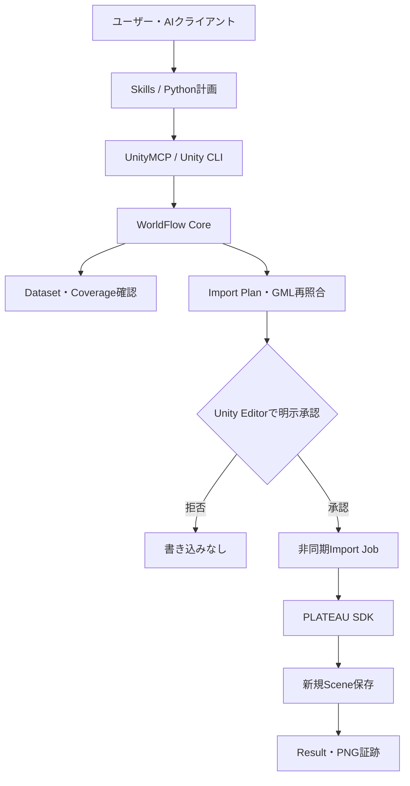

# システム構成

**AIとの読み取り専用計画**と、**Unity Editor内での承認付きImport**を分けて管理する設計です。

## 処理の流れ

外部の調査情報とUnity内で確認したデータの可用性は別々に扱います。UnityMCPと公式Unity CLIは同じCoreを呼び出します。

## 実装と責務

| 領域 | 役割 |
| --- | --- |
| `Editor/Setup` | SDKの診断、導入計画、Editor承認、再診断 |
| `Editor/Core/ReadOnly` | Dataset、メッシュ、Coverage、範囲案 |
| `Editor/Core` | 計画・Projectの照合、JSON、Import Jobの重複防止 |
| `Editor/Previewing` | 範囲の概略PNG生成 |
| `Editor/Plateau` | Local/Remoteデータ照合、SDKのImport、Scene保存 |
| `Editor/Entry` | Import承認画面、Job、証跡・復旧 |
| `Editor/UnityMcp` / `Editor/UnityCli` | 外部コマンドと共通処理の橋渡し |
| `.agents/skills`、`tools/planning.py` | 自然言語による場所・範囲・品質の計画 |

`Editor`は`Packages/com.darumappap.plateau-worldflow/Editor/`以下を指します。

## 変更と承認の境界

- **計画採用は実行承認ではありません。** Package導入とImportはUnity Editorの利用者が個別に確認します。
- Project、Dataset、メッシュ、地物・LOD、座標系、データ取得元を実行直前に照合します。
- Import先は専用の新規Sceneとし、既存Sceneの自動上書き・削除を禁止します。
- 不明なJobや残存Assetは自動再実行せず、証跡と実体の照合を求めます。
- 外部本文をAI実行命令として扱わず、認証情報や第三者データをGitへ含めません。

## データの保存先

| 内容 | パス |
| --- | --- |
| SDK診断・導入Job | `Library/PLATEAUWorldFlow/Setup/` |
| 範囲プレビュー | `Library/PLATEAUWorldFlow/Preview/` |
| Import Job・Result・PNG | `Library/PLATEAUWorldFlow/Import/jobs/<jobId>/` |
| Import後の新規Scene | `Assets/PLATEAUWorldFlow/Imports/<importPlanId>/City.unity` |

詳しい仕様は[Read-only](contracts/readonly.md)、[計画](contracts/planning.md)、[Import](contracts/import.md)と[互換性](compatibility.md)を参照してください。開発規約は[AGENTS.md](../AGENTS.md)です。
